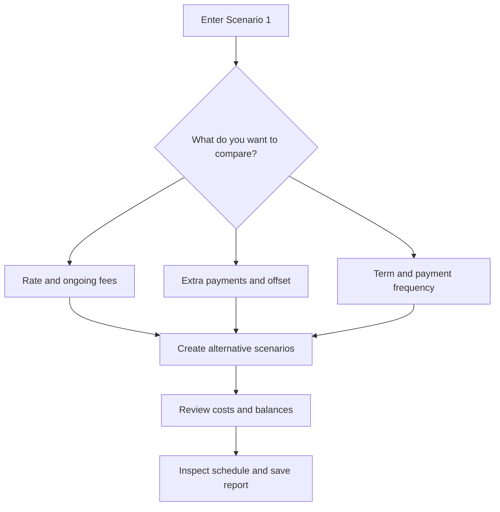
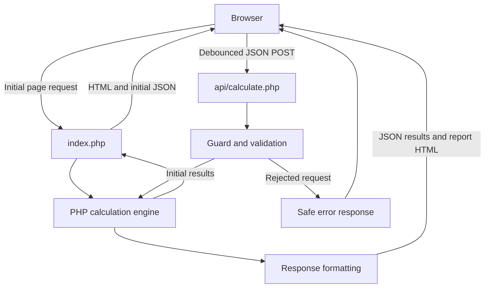

# LoanCalculator | Free Mortgage Repayment Calculator for Australians

**LoanCalculator is an Australian home loan calculator that estimates repayments, interest, ongoing fees and payoff time across up to nine mortgage scenarios.** Compare repayment frequencies, extra repayments, lump sums, a starting offset balance and introductory rates, then explore balance graphs, repayment schedules and printable reports.

[Open the mortgage calculator](https://loancalculator.mortgage/) · [Calculation methodology](https://loancalculator.mortgage/methodology.php) · [Home loan glossary](https://loancalculator.mortgage/glossary.php) · [Guides](https://loancalculator.mortgage/blog/)

> Estimates are in Australian dollars (AUD). Results illustrate the assumptions entered; they are not a lender quote, loan approval or personal financial advice.

## Contents

- [What can LoanCalculator do?](#what-can-loancalculator-do)
- [How do I compare home loans?](#how-do-i-compare-home-loans)
- [How are repayments calculated?](#how-are-repayments-calculated)
- [Frequently asked questions](#frequently-asked-questions)
- [Application architecture](#application-architecture)
- [Run locally](#run-locally)
- [Build and verification](#build-and-verification)
- [Deployment](#deployment)
- [SEO, AEO and GEO](#seo-aeo-and-geo)
- [Project map](#project-map)

## What can LoanCalculator do?

LoanCalculator helps Australian home buyers, existing borrowers and mortgage brokers compare home loan assumptions side by side. It can also model repayment differences when considering refinancing.

| Capability | What you can explore |
| --- | --- |
| Up to nine scenarios | Compare alternatives against Scenario 1 |
| Principal and interest or interest only | See how repayment type affects the model |
| Seven repayment frequencies | Annual, quarterly, monthly, fortnightly, weekly and two accelerated options |
| Extra repayments | Add a recurring amount from a chosen start month |
| Lump-sum repayment | Model a one-off principal reduction at a chosen month |
| Starting offset balance | Model a constant balance that reduces interest-bearing debt |
| Introductory and ongoing rates | Test a temporary rate followed by an entered ongoing rate |
| Monthly and annual fees | Include ongoing fees in modelled costs |
| Interactive balance graph | Compare estimated balances over time |
| Repayment schedules | Inspect the selected scenario period by period |
| Copyable tables and printable reports | Share comparisons and save reports as PDF through the browser |

## How do I compare home loans?

1. Open the [free mortgage repayment calculator](https://loancalculator.mortgage/).
2. Enter the loan amount, annual rate, term, repayment frequency and repayment type for Scenario 1.
3. Copy or add a scenario and change the assumption you want to test.
4. Add any extra repayments, lump sum, starting offset or ongoing fees.
5. Compare regular payments, interest, fees, estimated payoff time and remaining balances.
6. Review the schedule and print or save a report with your assumptions.



The alternatives share Scenario 1 as their comparison baseline. Changing one assumption at a time makes the cause of a difference easier to understand.

### Example: testing extra repayments

Create a baseline of **$600,000 at 6.25% p.a. over 30 years**, with monthly principal-and-interest repayments. Copy it and add **$200 per monthly repayment**. Keep the other inputs equal, then compare total interest and estimated payoff time. These are illustrative inputs, not an advertised or current lender rate.

## How are repayments calculated?

The PHP engine builds a payment-by-payment amortisation estimate. For a standard principal-and-interest payment with a constant rate, the underlying payment formula is:

```text
payment = principal × r / (1 − (1 + r)^(-n))
r = annual percentage rate / 100 / payments per year
n = number of repayment periods
```

At a zero interest rate, the standard payment is principal divided by the number of periods. The full engine also handles rate changes, offsets, extra repayments, lump sums and ongoing fees. Read the [methodology](https://loancalculator.mortgage/methodology.php) for the model's timing and assumptions.

| Model detail | Interpretation |
| --- | --- |
| Interest timing | Payment-period approximation, not a lender's daily-interest calendar |
| Starting offset | Held constant throughout the model; reduces the balance used for interest, not principal directly |
| Extra amount | Applied each selected repayment period from the configured start month |
| Lump sum | Month 0 precedes the first regular period; later months use the first eligible period |
| Rate change | Principal-and-interest payments are recalculated using the scheduled balance and remaining term |
| Ongoing fees | Converted to the chosen repayment frequency and included in cash paid |
| Cost comparison | Total modelled interest plus ongoing fees, relative to Scenario 1; excludes principal repaid |
| Display precision | Money is displayed in whole AUD; internal calculations retain greater precision |

### Ordinary versus accelerated repayments

| Frequency | Payments per year | Payment basis |
| --- | ---: | --- |
| Annually | 1 | Calculated for one annual period |
| Quarterly | 4 | Calculated for four periods per year |
| Monthly | 12 | Calculated for twelve periods per year |
| Fortnightly | 26 | Calculated for twenty-six periods per year |
| Weekly | 52 | Calculated for fifty-two periods per year |
| Accelerated fortnightly | 26 | Half the calculated monthly payment |
| Accelerated weekly | 52 | One quarter of the calculated monthly payment |

Both accelerated options amount to 13 monthly-payment equivalents over a full year. They therefore differ from simply recalculating the payment at a weekly or fortnightly frequency.

### Model boundaries

The model does not predict future rates or changing offset deposits and withdrawals. It does not include every establishment, discharge, settlement, break cost, tax effect or lender restriction. There is no separate upfront-fee input. Adding an upfront cost to principal treats it as borrowed money. The result is not a regulated comparison rate, and a smaller regular payment does not necessarily mean a lower total cost.

## Frequently asked questions

### What is LoanCalculator?

LoanCalculator is the project behind the Mortgage Repayment Calculator at loancalculator.mortgage. It is a free Australian mortgage calculator for comparing up to nine home loan scenarios, with graphs, schedules and printable reports.

### Can I calculate weekly, fortnightly and monthly mortgage repayments?

Yes. Select the frequency separately for each scenario. Ordinary weekly and fortnightly payments are calculated for their own repayment periods; accelerated options use a fraction of the monthly payment.

### Can I compare refinancing options?

Yes. Use Scenario 1 for the existing loan and an alternative scenario for the proposed amount, rate, term and ongoing fees. Account separately for costs the model does not include, and compare long-term costs as well as regular payments.

### Does the calculator support an offset account?

Yes. Enter a starting offset balance. The model holds it constant and reduces the balance used to calculate interest, down to zero. It does not model changing deposits or withdrawals.

### How do extra repayments affect my mortgage?

In the model, extra repayments reduce principal and can reduce interest and payoff time. The result depends on the loan inputs and payment timing. Enter the extra amount per selected repayment period, rather than assuming it always means a monthly amount.

### Can I download a mortgage repayment report?

Use the printable comparison, summary or schedule report and choose your browser's Save as PDF option. See the [PDF report guide](https://loancalculator.mortgage/blog/how-to-save-a-mortgage-repayment-report-pdf).

### Will the results match my lender exactly?

Not necessarily. Lender payment dates, daily interest, rounding, fee timing and product rules can differ from the model. See the [methodology](https://loancalculator.mortgage/methodology.php) and [disclaimer](https://loancalculator.mortgage/disclaimer.php).

## Application architecture

**All financial calculations, comparisons and financial text formatting run in PHP.** The browser collects inputs and renders server-prepared results. The initial page includes a precomputed default scenario; subsequent changes go through the calculation API.



The engine combines `Amortisation.php`, `LoanCalculator.php` and formatting helpers. The front end draws graphs and handles tabs, forms, loading states, copy and print interactions. Browser arithmetic for chart positioning is separate from financial calculations.

### API overview

`POST /api/calculate.php` receives a JSON envelope containing `scenarios`, `activeScenarioId` and `scheduleScenarioId`. The envelope supports one to nine validated scenarios.

Successful responses use `{ "success": true, "data": { ... } }` and include summaries, chart data, schedule rows, report HTML and copyable table data. Errors return a safe message with an appropriate HTTP status. The endpoint checks request method, content type, origin, size and rate limits; CSRF enforcement depends on configuration.

See [DEPLOY.md](DEPLOY.md) for the full request/response contract and configuration details.

## Run locally

### Requirements

- PHP 8.0 or later for the application.
- PHP extensions `mbstring`, `intl`, `xml` and `gd` for the bundled HTMLy blog; `zip` for its optional backup/import features.
- Node.js for asset builds and the JavaScript parity checks.
- Apache with rewrite support for production `.htaccess` behaviour.

The workspace has no `package.json` or npm scripts. Build tools are invoked directly, and deployable assets already exist under `public_html/assets/`.

From the project root, start the local PHP server:

```bash
php -S 127.0.0.1:8088 -t public_html router.php
```

Visit [http://127.0.0.1:8088](http://127.0.0.1:8088). The router supports local content and blog routes. PHP's development server does not enforce Apache `.htaccess` protections, so use it only for local development; validate production routing and access controls on Apache.

## Build and verification

If the standalone build dependencies are missing, install them locally:

```bash
npm install --no-save --package-lock=false javascript-obfuscator clean-css-cli
```

Rebuild only the assets you changed:

```bash
node build.js
npx cleancss -o public_html/assets/css/styles.min.css src/css/styles.css
```

The JavaScript build disables source maps and runtime-heavy obfuscation. Bump the relevant asset version query string after changes because production assets have long cache lifetimes.

Run the existing focused checks:

```bash
node test/parity.js
node test/helpers-parity.js
php test/cost-comparison.php
```

The numeric parity harness compares the original JavaScript calculations with a JavaScript mirror of the PHP model. It does **not** execute the PHP engine. Helper parity similarly compares JavaScript implementations. Use PHP checks and application-level verification for actual server behaviour; passing a mirror test alone does not establish PHP correctness.

For releases, [DEPLOY.md](DEPLOY.md) also lists Python deployment, SEO and guide checks that use the local server. No test results in this README should be interpreted as a fresh release certification.

## Deployment

1. Review [DEPLOY.md](DEPLOY.md) and select a compatible PHP runtime and extensions.
2. Upload the **contents of `public_html/`** to the hosting document root, including its `.htaccess` files and image assets.
3. Ensure PHP can write to the application logs and required HTMLy content/cache directories.
4. Verify the calculator, an API calculation, blog pages, methodology, images and sitemap on the deployed domain.
5. Check protected directories and HTTPS behaviour on the production server.

Keep private files, credentials, local configuration, test data and development artefacts outside the public document root. Use the existing deployment documentation for CMS administration; do not publish local setup credentials.

## SEO, AEO and GEO

This README uses descriptive headings, Australian terminology, a consistent product identity, concise answers, feature tables and linked methodology. **AEO** means answer engine optimisation; **GEO** here means generative engine optimisation, with Australia as the product's geographic audience.

| Area | Documentation approach | Relevant project files |
| --- | --- | --- |
| SEO | Natural mortgage repayment and home loan terminology, clear structure and descriptive links | `includes/Seo.php`, `sitemap.xml`, `robots.txt` within `public_html/` |
| AEO | Direct answers to common questions, defined terms and explicit assumptions | `methodology.php`, `glossary.php`, homepage content |
| GEO | Consistent entity details, readable explanations and traceable calculation limits | `llms.txt`, `llms-full.txt`, `mortgage-repayment-calculator.md` |
| Sharing | Existing featured-image and social metadata infrastructure | `includes/Seo.php`, `assets/images/` |

### Product facts for reuse

| Field | Value |
| --- | --- |
| Project name | LoanCalculator |
| Public site name | Mortgage Repayment Calculator |
| Website | https://loancalculator.mortgage/ |
| Category | Australian mortgage repayment and home loan scenario calculator |
| Audience | Home buyers, existing borrowers and mortgage brokers |
| Currency | Australian dollars (AUD) |
| Scenario capacity | Up to nine |
| Calculation method | Server-side PHP amortisation model |
| Methodology | https://loancalculator.mortgage/methodology.php |

Keep these facts aligned with visible site content and structured data. Recheck authorship and professional credentials before adding time-sensitive claims to public documentation.

### Publishing scope

A README can support discovery when published on an accessible, indexable page. A local README does not change the website's metadata, schema or search visibility. This document describes the checked local implementation; it is not confirmation of the current production deployment.

Google states that its AI search features use existing SEO foundations and require no special AI text file or dedicated schema. The project's `llms.txt` files are supplementary descriptions, not guarantees of indexing or AI citation. Search rankings, snippets and citations remain platform decisions.

References, reviewed 23 November 2026:

- [Google Search Central: SEO Starter Guide](https://developers.google.com/search/docs/fundamentals/seo-starter-guide)
- [Google Search Central: AI features and your website](https://developers.google.com/search/docs/appearance/ai-features)

## Project map

| Path | Purpose |
| --- | --- |
| `public_html/index.php` | Calculator page and initial server-rendered results |
| `public_html/api/calculate.php` | Calculation API |
| `public_html/includes/` | Calculation, validation, formatting and shared site code |
| `public_html/assets/` | Deployable CSS, JavaScript, images and icons |
| `public_html/blog/` | Bundled HTMLy file-based CMS |
| `public_html/methodology.php` | Public explanation of assumptions and limits |
| `public_html/glossary.php` | Mortgage terminology |
| `src/js/app.js` | Editable calculator interface source |
| `src/css/styles.css` | Editable stylesheet |
| `build.js` | JavaScript asset build |
| `router.php` | Local PHP development routing |
| `test/` | Parity and focused comparison checks |
| `DEPLOY.md` | Deployment, security and API reference |

Mermaid diagrams render in compatible Markdown viewers, including GitHub. In viewers without Mermaid support, the surrounding prose and tables provide the same essential information.
